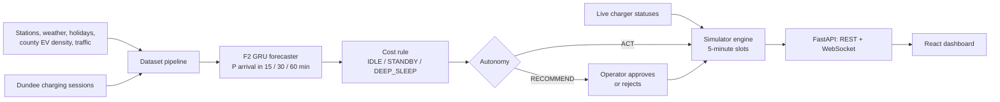

# PPCnodowntime

An AI agent that puts idle PPC Blue EV charge points to sleep and wakes them before a car arrives, so the network wastes less electricity without making drivers wait.

Built in under 24 hours for a PPC hackathon challenge. It runs on a simulator and on collected live statuses. **It does not control real hardware.**

- [The problem](#the-problem)
- [How it works](#how-it-works)
- [Results](#results)
- [What is real and what is simulated](#what-is-real-and-what-is-simulated)
- [Run the app](#run-the-app-docker-the-team-standard-decision-0077)
- [Repository map](#repository-map)

## The problem

A public charge point stays powered around the clock, even with no car plugged in. Many sit unused for hours at night, on quiet highway stretches and at retail sites after closing. A fixed off-schedule is crude: it ignores holidays, weather and drivers already on their way, and a driver who reaches a sleeping charger has to wait for it to wake.

So the question is: **how much idle energy can we save, and what does it cost drivers in waiting time?** Every policy here is measured on those two numbers, on the same days.

## How it works



### 1. Charge point states

The agent acts on each charge point (CP) separately, every 5 minutes. It can command one of three target states:

| Class | IDLE | STANDBY | DEEP_SLEEP | Wake from standby / deep sleep |
|---|---|---|---|---|
| AC 22 kW | 25 W | 9 W | not available | 10 s / – |
| DC 50 kW | 105 W | 35 W | 20 W | 10 s / 180 s |
| DC high power | 165 W | 50 W | 25.5 W | 10 s / 180 s |

These are the class defaults in `config/power_profiles.yaml`. The simulator refines them per CP from a capacity table. A CP can also be `CHARGING`, `WAKING` or `OFFLINE`, but a policy can't command those.

### 2. Forecasting demand

A GRU (`model/experiments/f2_gru.py`) reads the last 36 slots for a CP and predicts when the next EV will arrive, using a discrete-time survival head. That yields the probability of an arrival within 15, 30 and 60 minutes.

It models electric demand specifically, rather than general traffic. Features include time of day, weekday, holidays, weather, recent arrivals at the CP and its site, county EV density, PPC Blue route intents, and Maps counts where EVs carry full weight and combustion cars 0.05.

There are two trained models in `artifacts/`:

| File | Used for | Inputs |
|---|---|---|
| `f2_gru.pt` | Replay and evaluation | All features, including the mocked app and Maps signals |
| `f2_gru_live.pt` | Live mode | Calendar, CP and site history only (no mocked signals), plus a calibration fitted on real arrivals |

### 3. Deciding

For each CP that isn't charging, a cost rule (`model/cost_rule.py`) picks the state with the best trade-off:

```
E_save(s) = energy saved by sleeping in state s for one slot
C_wait(s) = P(arrival) × wake_time(s) in minutes × λ
choose the state that maximises E_save(s) − C_wait(s)
```

λ is the price of one minute of driver wait, in kWh (default 0.1). Two guardrails sit on top: a route intent arriving within the wake time plus 5 minutes forces the CP awake, and at least one CP of each power class stays awake at a location unless the forecast is very confident nobody is coming.

> **Why the policy is called `rl_ppo` but isn't RL.** The project started with reinforcement learning as the main product. The RL agents were never trained at full scale, and the only PPO model on hand made 94% of drivers wait in a replay, so the team dropped it ([decision 0069](docs/decisions/0069-f2-gru-is-the-agent.md)). The agent is a trained forecaster plus a decision rule. It still uses the `rl_ppo` slot so the frontend didn't have to change, which is why `rl_ppo` and `cost_rule` score the same. `docs/PRD.md` and parts of `docs/specs/02-model-agent.md` still describe the original RL plan.

### 4. Simulating

One engine (`sim/engine.py`) serves training, replay and live mode. Each 5-minute slot it builds the state, asks every policy for commands, applies them, processes arrivals and departures to the second, and adds up energy.

Every policy gets its own copy of the network and sees the same sessions, so results compare directly. Drivers are never lost: one who finds a sleeping charger first takes any compatible awake CP at the site, and otherwise waits for the one that's ready soonest. That wait is the "added wait" metric.

### 5. Operating

The dashboard shows a Romania map with each CP's state and a swipe between the network with and without the agent. It also has KPIs against always-on, replay controls, and a station panel with state history and forecasts.

The global autonomy switch sets how commands are handled. In **ACT** the agent applies them. In **RECOMMEND** (labelled "Review") an operator approves or rejects each one. A replay pauses when new recommendations appear, and any left undecided expire after three slots.

The app has four ways to run:

| Mode | Data | Purpose |
|---|---|---|
| Replay | Test days covered by `forecasts.parquet` | Play a day at any speed, all policies side by side |
| Live | Real statuses collected from AmpWhere | The agent runs in shadow. KPIs are estimates of what it would have saved |
| Fixtures (`API_FIXTURES=1`) | Recorded day in `fixtures/api/` | Run the API without the private data |
| Browser demo | Generated in the frontend | Fallback when no backend is reachable, driven by a rule-based stand-in rather than the real agent |

## Results

From the committed `artifacts/eval_results.json`: 8 test days in March–April 2025 (including Orthodox Easter), 3,679 sessions, λ = 0.1.

| Policy | Idle energy saved | Mean added wait | Sessions that waited |
|---|---|---|---|
| Always on (today) | 0% | 0 | 0 |
| Naive quiet hours (3 h fixed window) | 9.6% | 0.126 min | 165 |
| **Agent (F2 GRU + cost rule)** | **56.5%** | **0.035 min (about 2 s)** | **96 (2.6%)** |
| Oracle (knows the future, upper bound) | 78.8% | 0 | 0 |

Read these as simulated results: the sessions are UK data mapped onto Romanian chargers, and the wattages aren't measured on PPC hardware (next section).

## What is real and what is simulated

| Input | Status |
|---|---|
| Station list: 445 locations, 671 charge points, 1,364 connectors | Real, from an AmpWhere snapshot. Not an official PPC list |
| Live charger statuses | Real, collected from AmpWhere |
| Charging sessions: 981,486 | Real sessions from Dundee City Council (UK, 2021–2025), mapped onto Romanian CPs and scaled by county EV density and site type |
| Weather, holidays, county EV registrations, typical traffic | Real (Open-Meteo, `holidays` package, DRPCIV, Mapbox / TomTom) |
| PPC Blue route intents | **Mocked**, generated from the sessions: 60% of sessions, 10–40 minutes ahead |
| Waze / Google Maps EV and combustion counts | **Mocked**, with 25% of EVs tagged |
| Idle, standby and deep-sleep power | **Assumed**, from `engineering/engineering_plan.md`, not measured on PPC hardware |

`LIVE_SIGNALS=off` runs live mode with no mocked signals at all.

Data handling: Dundee raw files, AmpWhere scrapes and anything derived from them stay out of git (`data/raw/`, `data/processed/`) and are shared privately within the team. The repo holds a 116-location open seed (`data/seed/stations_open.csv`), fixtures and trained models. AmpWhere's terms and `robots.txt` restrict automated access, so a person has to start the collector deliberately and AI agents must not run it ([decision 0003](docs/decisions/0003-live-status-collection.md)).

## Run the app: Docker (the team standard, decision 0077)
Everyone runs and demos the app with Docker. Needs Docker with **at least 4 GB of memory** (Windows: `memory=4GB` under `[wsl2]` in `%USERPROFILE%\.wslconfig`, then `wsl --shutdown`).

```
cp .env.example .env          # set DATA_HOST_DIR to the folder with the private data (data/processed, data/raw/live)
docker compose up -d --build  # or: make up
```
Open **http://localhost:8080** and enter the **access key** (decision 0087): `PPC_ACCESS_KEY` from `.env`, or, when that is empty, the key `ppc-api` generates and logs at every start: `docker compose logs ppc-api | grep "access key"`. The browser keeps a login cookie for 30 days, or until the key changes. `PPC_AUTH=off` in `.env` turns the key off locally. Containers have CPU and memory caps (`API_CPUS`, `API_MEM_LIMIT`, …, see `.env.example`).

nginx (`ppc-web`) is the single entry point and proxies `/api` and `/ws` to `ppc-api`; `ppc-db` is Postgres + PostGIS; `ppc-seed`/`ppc-migrate` run once.
- Real mode needs the private data (`data/processed/`, incl. `forecasts.parquet`) and `artifacts/` (committed). Without data set `API_FIXTURES=1`.
- The agent is F2 GRU + cost rule (`RL_AGENT=auto`, decision 0069). Check: `docker compose logs ppc-api | grep "served by"`.
- Live demo on collected statuses: `LIVE_CLOCK_START=2026-11-07T19:30:00+02:00` and `LIVE_CLOCK_SPEED=30` in `.env`. Real-time live needs the collector: `docker compose --profile live up -d ppc-collector` with `AMPWHERE_ENABLED=1` (a human enables it, decision 0003).
- Open **http://localhost:8080/?mode=live** to start on the live network (decision 0080). Live needs `data/processed/source_refs.parquet` (`uv run python -m stations` builds it from the collected AmpWhere snapshot). After changing `.env`, recreate the API (`docker compose up -d ppc-api`) so it picks up `LIVE_CLOCK_*`.
- After changing code: `docker compose up -d --build`, then reload the page (an API restart drops in-memory runs; a stale page falls back to demo data).
- Stop: `docker compose down`. Logs: `docker compose logs -f ppc-api`.

Server (behind Traefik, decision 0066): `cp .env.example .env`, fill the server block (`COMPOSE_FILE`, `TRAEFIK_NETWORK`, `PPC_HOST`), a strong `POSTGRES_PASSWORD` and a fixed `PPC_ACCESS_KEY`, make sure `data/` and `artifacts/` are present, then `docker compose up -d --build`. Nothing is published on the host; Traefik routes to `ppc-web`.

## Development tools (not for running the app)
Needs [uv](https://docs.astral.sh/uv/) and Node 20+.
```
make test    # pytest + frontend tests
make lint    # ruff
make data    # M1: build processed datasets (needs data/raw/)
make train   # M2: train the F2 GRU (model.experiments); GPU training: see below
```
`make api` / `make web` still work for debugging a single module, but demos, reviews and "does it work" checks use Docker.

## Repository map

| Path | What's there |
|---|---|
| `dataset/` | Dundee ingest, donor mapping, mocked signals, weather, traffic, live collector |
| `stations/` | Station import, state rules, power profiles, the `stations.store` DB API |
| `model/` | Forecasters, cost rule, RL experiments, training CLI (`model.experiments`) |
| `sim/` | Slot engine, baselines, metrics, Gymnasium environment, evaluator, live engine |
| `api/` | FastAPI app: replay and live runs, recommendations, access key |
| `frontend/` | React 18 + TypeScript + Vite dashboard with an interactive SVG map |
| `artifacts/` | Promoted models and `eval_results.json` |
| `config/` | Power profiles, simulator, signals, live collector, training configs |
| `db/`, `docker/` | SQL migrations, Dockerfiles and helper scripts |

| Document | Read it for |
|---|---|
| [`AGENTS.md`](AGENTS.md) | How people and AI agents work together on this repo (mandatory) |
| [`TASKS.md`](TASKS.md) | Who is doing what |
| [`docs/PRD.md`](docs/PRD.md) | Original product goals |
| [`docs/CONTRACTS.md`](docs/CONTRACTS.md) | API routes, schemas, env vars, ports |
| [`docs/specs/`](docs/specs/) | Foundation and per-module specs. Conventions: [`00-foundation.md`](docs/specs/00-foundation.md) |
| [`docs/DECISIONS.md`](docs/DECISIONS.md) | Why things are the way they are |
| [`docs/LIVE_DATA.md`](docs/LIVE_DATA.md) | Collecting and reading live statuses |
| [`docs/TRAINING_GPU.md`](docs/TRAINING_GPU.md) | Forecaster training on a GPU server |
| [`docs/figures/`](docs/figures/) | Architecture figures. Some still show the RL agents dropped in decision 0069 |

## Training on the GPU server
Reproducible runs in Docker (decision 0051). Needs Docker with the NVIDIA container toolkit.

```
make train-image                                   # build ppc-train:latest (stamps git sha)
make train-docker CONFIG=config/train/smoke.yaml SEED=0 GPU_ID=1   # one run on host GPU 1
GPU_ID=1 docker compose -f docker-compose.train.yml run --rm train run config/train/smoke.yaml --set params.epochs=10
make train-suite-docker SUITE=config/train/suites/smoke_seeds.yaml # several runs + summary table
docker compose -f docker-compose.train.yml run --rm train promote runs/<run_id>   # into artifacts/
make train-local CONFIG=config/train/smoke.yaml    # no Docker (CPU or local GPU)
```

- Data is mounted read-only from `./data`. Runs go to `./runs/<run_id>/` (gitignored): config, manifest, metrics, log, model. Suites write `runs/suites/<name>-<hash>/summary.{csv,md}`.
- Nothing reaches `artifacts/` until `promote`. Promote also writes `<name>_provenance.json`.
- Same config, seed, data and image give the same `metrics.json` on the same GPU model and driver (the manifest records both).
- Demo forecasts (decision 0069): `python -m model.experiments predict <run_dir_or_f2_gru.pt> --start 2025-02-28 --end 2025-04-29 --out data/processed/forecasts.parquet` (UTC days; 2025-02-28 is needed so local day 2025-03-01 is fully covered; `--data-dir`, `--chunk-days` optional; also `python -m model.gru_forecaster`). When that file exists the API and evaluator offer only the days it fully covers.
- Add a trainer: write `train(ctx: RunContext) -> dict` with `@register("f2_gru", kind="forecaster", promote={...})` and add one line `"f2_gru": "model.experiments.f2_gru:train"` to `MODULES` in `model/experiments/registry.py`.
